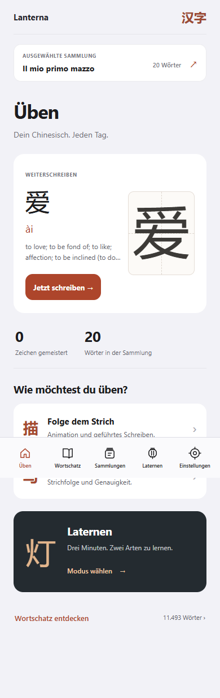
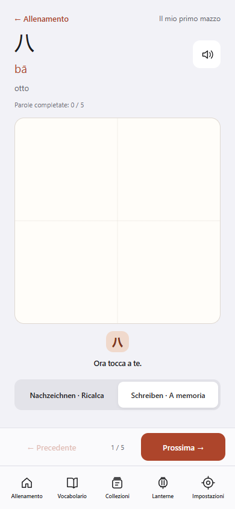

# Lanterna Hanzi

Eine Android-App zum Lernen chinesischer Schriftzeichen und Wörter: mit Strichfolge, Schreibübungen, eigenen Sammlungen und einem Laternenspiel. Die Oberfläche ist auf **Deutsch und Italienisch** verfügbar.

<p>
  
  
</p>

## Funktionen

- **11.493 Wörter** aus einem HSK-2.0-/3.0-Datensatz und ergänzten A1-Lernwörtern; Strichdaten für **3.037 unterschiedliche Zeichen**.
- **Nachzeichnen:** Animation ansehen und die Zeichen mit Vorlage schreiben.
- **Schreiben:** ohne Zeichenumriss üben; geprüft werden Strichfolge, Richtung und Position. In den normalen Übungen wird bei Fehlern der passende Strich gezeigt.
- **Sammlungen:** Wörter suchen, hinzufügen, entfernen, anhören und als JSON sichern oder importieren.
- **Übungsrunden:** Der ausgewählte Stapel wird einmal zufällig gemischt. Jede Karte hat eine feste Position im Durchgang. Zurück/Weiter bleiben beim Schreiben sichtbar; übersprungene Wörter bleiben offen. Erst wenn alle Wörter vollständig geschrieben sind, beginnt auf Wunsch eine neue Runde.
- **Fortschritt:** Reihenfolge, Position und abgeschlossene Zeichen werden für jede Sammlung lokal gespeichert.
- **Mandarin-Audio:** ganze Wörter über die Sprachausgabe des Geräts.
- **Offline:** Wortschatz und Strichdaten sind enthalten. Für Offline-Audio muss eine passende chinesische Stimme auf dem Gerät installiert sein.

### Laternenspiel

Eine Runde dauert **drei Minuten**, mit **drei Leben** und jeweils **drei Pinyin-Antworten**. Nach der richtigen Antwort wird das Wort Zeichen für Zeichen geschrieben. Nach jeweils fünf abgeschlossenen Zeichen sinken die Zeitlimits. Eine falsche Antwort oder abgelaufene Zeit kostet ein Leben.

- **Mit Anleitung:** Zeichenanimation, sichtbare Vorlage und wiederholte Animation des nächsten Strichs. Das Schreibzeitlimit beginnt nach der anfänglichen Animation; die Gesamtspielzeit läuft weiter.
- **Auswendig:** Nach der Auswahl wird das Zeichen verborgen. Es gibt weder Vorlage noch Strichhinweise, auch nach Fehlern. Die Prüfung der Eingabe bleibt aktiv.

Für beide Modi werden getrennte Bestleistungen gespeichert. Zum Spielen braucht die Sammlung mindestens drei unterschiedliche Pinyin-Lesungen.

### A1 LehrBuch

Die mitgelieferte Sammlung **A1 LehrBuch** enthält **74 Einträge**: 64 Wörter aus den bereitgestellten Vokabellisten sowie die Zahlen **一 二 三 四 五 六 七 八 九 十**. Diese Einträge haben deutsche und italienische Bedeutungen; die übrigen Wörterbuchdefinitionen sind überwiegend auf Englisch.

Die Lehrbuchfotos und darin abgebildeten Personen sind **nicht Bestandteil des Repositorys**. Die App führt kein automatisches Foto-OCR aus.

## Technik

| Bereich | Umsetzung |
| --- | --- |
| Oberfläche | HTML, CSS, JavaScript als ES-Module |
| Web-Build | Vite 6 |
| Android-Laufzeit | Capacitor 7 / Android WebView |
| Schreiben | Hanzi Writer und lokale Strichdaten |
| Aussprache | Capacitor Text-to-Speech / Web Speech API |
| Datenhaltung | lokaler Gerätespeicher, JSON-Import/-Export |
| Tests | Node.js-Test-Runner und Playwright |

Die App benötigt kein Benutzerkonto und keinen eigenen Backend-Server. Dies ist ein eigenständiges Lernprojekt und kein offizielles Produkt der App „Chinese Writer“.

## Lokal starten

Voraussetzung: **Node.js 22** mit npm.

```sh
git clone https://github.com/BruhUMadLol/lanterna-hanzi.git
cd lanterna-hanzi
npm ci
npm run dev
```

Vite zeigt die lokale Adresse an, normalerweise `http://localhost:5173`.

Die vorbereiteten Wörter und Strichdaten liegen bereits im Repository. Um sie nach Änderungen an den Lernwörtern erneut zu erzeugen:

```sh
node scripts/prepare.mjs
```

## Android-APK bauen

Benötigt werden **JDK 21**, das **Android SDK mit Plattform 35** und passende Android-Build-Tools, zum Beispiel über Android Studio. `JAVA_HOME` muss auf JDK 21 und `ANDROID_HOME` auf das installierte SDK zeigen.

```sh
npm ci
npm run build
npx cap sync android
```

Anschließend unter Windows:

```powershell
cd android
.\gradlew.bat assembleDebug
```

Unter macOS/Linux:

```sh
cd android
./gradlew assembleDebug
```

Die installierbare Debug-APK liegt danach unter:

```text
android/app/build/outputs/apk/debug/app-debug.apk
```

Das Projekt unterstützt Android ab API 23 (Android 6), mit einer zur Capacitor-Version passenden Android System WebView. Die Debug-APK wird mit dem lokalen Debug-Schlüssel signiert. **Updates einer bestehenden Installation benötigen denselben Signierschlüssel.** Signierschlüssel, lokale SDK-Pfade und bereits gebaute APKs sind nicht im Repository enthalten.

Eine native iOS-Version ist bisher nicht eingerichtet oder getestet. Für einen späteren iOS-Build wären ein Mac, Xcode und eine passende Apple-Signierung erforderlich.

## Tests

Logik- und Datenprüfungen:

```sh
npm test
```

Browserprüfungen gegen den Produktions-Build:

```sh
npm run build
npx playwright test
```

Die Playwright-Konfiguration verwendet **Microsoft Edge** (`msedge`). Edge muss auf dem Testrechner installiert sein. Der lokale Testserver auf Port 5176 wird automatisch gestartet und beendet. Mit `TEST_URL` kann stattdessen ein bereits laufender Server verwendet werden.

Geprüft werden unter anderem Sammlungen, lokale Speicherung, Sprachwechsel, Scrollpositionen, echte gezeichnete Striche, Spielzeit/Leben, beide Spielmodi sowie komplette zufällige Übungsrunden ohne automatische Wiederholungen.

## Projektaufbau

```text
src/                     Oberfläche, Spiel- und Übungslogik
src/locales/de.json      Deutsche Übersetzungen
public/data/             Wörterbücher, Lernpakete, Strichdaten und Datenlizenzen
scripts/prepare.mjs      Reproduzierbare Aufbereitung der Vokabeln und Strichdaten
tests/                   Logik-, Daten- und Browserprüfungen
android/                 Natives Capacitor-Android-Projekt mit Gradle-Wrapper
docs/images/             Ausgewählte Screenshots der App
```

## Lernwörter erweitern

1. Vokabeln mit einer festen numerischen ID, chinesischer Schreibweise, Pinyin und Bedeutungen in `public/data/a1-lehrbuch.json` ergänzen. Bestehende IDs dürfen nicht neu vergeben werden.
2. Den Eintrag in `public/data/lessons.json` ergänzen und die `revision` des Pakets erhöhen.
3. `node scripts/prepare.mjs` ausführen und die verfügbaren Strichdaten prüfen.
4. Tests, Web-Build und Android-Build ausführen.

Neue Paketrevisionen ergänzen die zugehörige Sammlung, ohne persönliche Sammlungen oder die aktive Auswahl zu ersetzen. Eine bereits angewendete Revision wird nicht bei jedem Start erneut importiert. Fehlt ein Wort im ursprünglichen Wörterbuch, erhält es einen festen zusätzlichen Eintrag; bei vorhandenen Wörtern bleiben deren IDs erhalten.

## Grenzen und Datenquellen

Die Schreiberkennung ist eine Prüfung des **vorgegebenen Zeichens**, kein allgemeines Handschrift-OCR. Die Qualität und Offline-Verfügbarkeit der Aussprache hängen von der installierten Mandarin-Stimme ab. Mehrdeutige Lesungen und Tonsandhi können von der angezeigten Wörterbuchlesung abweichen; die Audios wurden nicht einzeln für jedes Wort aufgenommen oder geprüft.

Die HSK-Stufen stammen aus dem verwendeten Datensatz und sind keine Zusicherung der Übereinstimmung mit einem bestimmten aktuellen Prüfungsprogramm.

Quellen, Lizenztexte und Hinweise zu den vorgenommenen Datenänderungen stehen in **[THIRD_PARTY_NOTICES.md](THIRD_PARTY_NOTICES.md)**. Für den eigenen Anwendungscode wurde bisher keine gesonderte Projektlizenz festgelegt.
